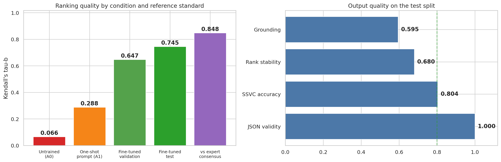
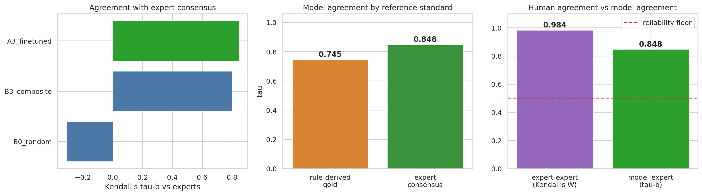

# MCASM: Prioritising Multi-Cloud Security Findings with a Small Language Model

Security teams running workloads on AWS, Azure and GCP face hundreds of findings in three incompatible formats, and no principled way to decide what to fix first. This project asks a narrow question: **can a small, locally runnable language model learn to triage cloud misconfigurations the way a security expert would?**

I normalise findings from all three providers into one schema, fine-tune a 3B-parameter model with QLoRA on a single T4 GPU, and measure its ranking against an independent expert consensus.



## Key results

| Measure (held-out data) | Result |
|---|---|
| Ranking agreement with the reference ranking (Kendall's τ-b, test) | **0.745**, versus 0.066 untrained and 0.288 one-shot (all p < 0.001) |
| Agreement with an independent two-rater expert consensus | **0.848** (model) vs 0.800 (hand-built rule system) vs −0.312 (random) |
| Model vs rule system | **Not significantly different** (p = 0.506, 6 expert sets) |
| Valid structured (JSON) output | 73.3% → **100%** |
| Rank stability under input re-ordering | 0.680 |
| Explanation grounding precision | 0.595 (about 40% of claims unsupported by the input) |

**How to read this:** the fine-tuned model matches a well-designed rule system on expert agreement and adds written explanations, but it does not beat it. Stability and grounding are below what autonomous use would need, so the system is best seen as **analyst-assisted triage**.

## Approach

1. **Corpus** (`01`). Six commit-pinned, deliberately vulnerable Infrastructure-as-Code repositories (TerraGoat, AWSGoat, AzureGoat, GCPGoat, iam-vulnerable, CNAPPGoat) were scanned statically, and five of them produced findings. No live infrastructure was touched. This gave **1,009 findings on 340 resources** (AWS 699, Azure 211, GCP 99).
2. **Unified Finding Schema.** Each finding keeps exposure, identity, data and blast-radius evidence in a provider-neutral form. A composite reference score and an SSVC-style outcome class (Track, Track\*, Attend) were adapted for misconfigurations, where the flaw itself is the exploit.
3. **Ranking task** (`02`). Findings are aggregated to resources and sampled into **1,500 ranking instances of about 12 resources each** (1,200 train, 150 validation, 150 test). Splits are made by resource, with zero overlap across splits, to prevent leakage.
4. **Model** (`03`, `04`). Qwen2.5-3B-Instruct with QLoRA (rank 16, about 30M trainable parameters). Training ran on a T4 for roughly 5.4 hours. Baselines: untrained, one-shot, random, alphabetical and the rule-based score.
5. **Evaluation** (`05`). Test-set ranking, rank stability, explanation grounding, and a separate expert study (2 raters, 45 findings, Kendall's W = 0.984 between raters).
6. **Prototype** (`06`). A small Streamlit viewer and 12 design principles drawn from the evidence.

## Results at a glance

| | Untrained | One-shot | Fine-tuned (val) | Fine-tuned (test) |
|---|---|---|---|---|
| Kendall τ-b | 0.066 | 0.288 | 0.647 | **0.745** |
| JSON validity | 73.3% | 95.0% | 100% | 100% |
| SSVC class accuracy | 6.4% | 24.7% | 80.6% | 80.4% |



## What this does not show

- **Reference ranking is rule-derived.** The 0.745 is agreement with a ranking built from a composite score, and a rule system that reproduces that score trivially reaches 0.94. The fair comparison is the independent expert study, which is small (6 sets).
- **Synthetic-style corpus.** Findings come from intentionally vulnerable repositories, so they are cleaner and more severe than a production estate. Live SDK discovery is not implemented.
- **Stability and grounding** are moderate (0.680 and 0.595).
- **Short training.** Training ended at 1.4 of 2 planned epochs.

## Repository map

```
notebooks/   01 corpus → 02 ranking instances → 03 baselines → 04 QLoRA → 05 evaluation → 06 prototype
results/     figures/ (12 plots), tables/ (every number above), manifests, sample report
app/         Streamlit prototype and demo data (streamlit run app/app.py)
data/        source repository pins (commit hashes) and corpus manifests
```

The notebooks were written for Google Colab (T4 GPU) and keep their saved outputs. Paths point to a mounted Drive folder; set them to a local directory to run elsewhere. The trained adapter and the full ranking corpus are not stored here because of size.

## Data and ethics

All inputs are public, open-source "vulnerable by design" repositories, pinned by commit in `data/provenance.json`. Please respect each repository's own license if you rebuild the corpus.

## License

MIT for the code in this repository.
